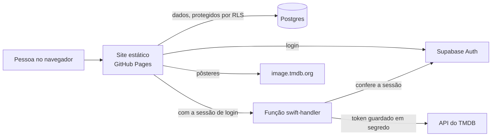
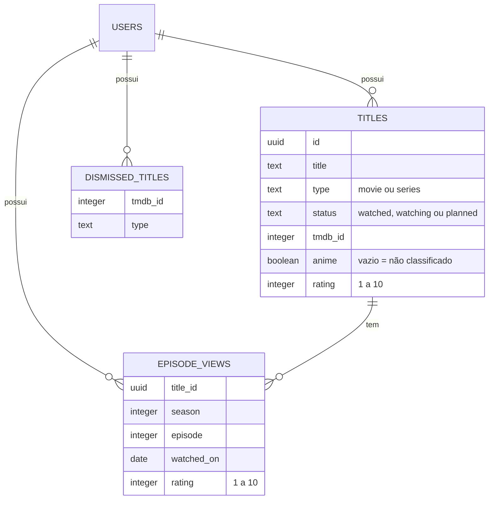
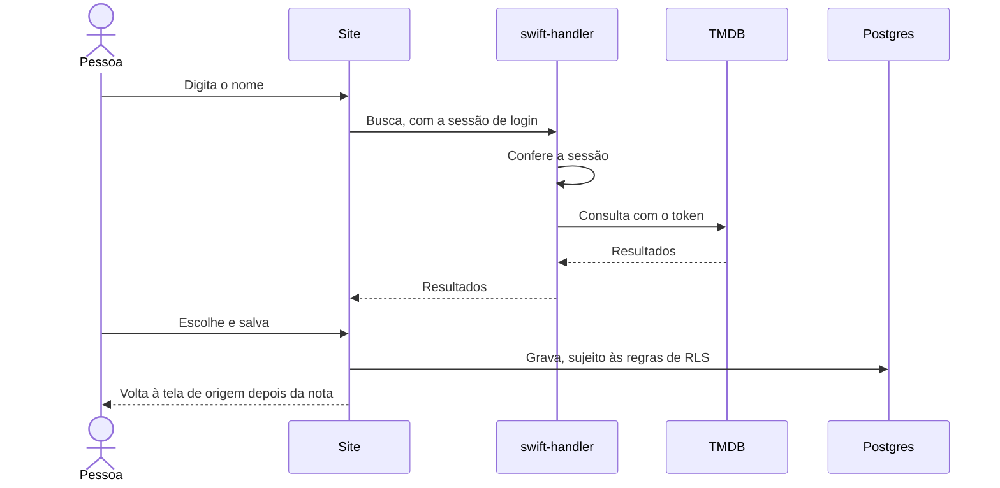

# Arquitetura

O Claquete é um site estático, sem servidor próprio. O navegador fala direto com o Supabase, e o TMDB só é alcançado por uma função que guarda o token.

## Visão geral

## Componentes

| Componente | Local | Responsabilidade |
| --- | --- | --- |
| Estrutura | `index.html` | Todas as telas, ícones e a política de segurança (CSP) |
| Estilos | `css/styles.css` | Identidade visual e layout |
| Configuração | `js/config.js` | Escolhe o ambiente pelo endereço |
| Dados | `js/store.js` | Login, validação, banco, chamadas à função e backup. Não toca no DOM |
| Recomendação | `js/recomendacoes.js` | Lê o gosto e pontua candidatos. Não toca no DOM nem no banco |
| Interface | `js/app.js` | Rotas, telas e modal. Texto externo entra por `textContent` |
| Função | `supabase/functions/buscar-titulos/index.ts` | Busca, detalhes, temporadas e recomendações no TMDB |
| Banco | `supabase/schema.sql` e `supabase/migracoes/` | Tabelas e regras de acesso |

Os scripts são carregados sem build, nesta ordem: Supabase (jsDelivr, com versão fixa e SRI), `config.js`, `store.js`, `recomendacoes.js` e `app.js`.

## Telas

As rotas ficam no hash da URL, porque o GitHub Pages só serve arquivos estáticos.

| Rota | Tela |
| --- | --- |
| `#/` | Biblioteca, com **Continue assistindo** |
| `#/quero-assistir` | Fila de títulos |
| `#/para-voce` | Recomendações |
| `#/titulo/<id>` | Página do título |
| `#/diario` | Sessões por mês |
| `#/estatisticas` | Números e gráficos |

## Dados

A lista completa de campos está em [Formato dos dados](referencia/formato-dos-dados.md). O site carrega as três tabelas ao entrar e mantém uma cópia em memória, atualizada a cada gravação.

## Fluxos principais

### Adicionar um título

### Marcar um episódio

As gravações de episódios passam por uma fila em `js/store.js`, para que cliques rápidos não sobrescrevam uns aos outros. O progresso do título é sempre o episódio marcado mais adiantado.

### Recomendar

1. `lerGosto` transforma notas em pesos e escolhe até 8 títulos de referência e 3 gêneros favoritos.
2. A função consulta as recomendações do TMDB para as referências e títulos bem avaliados dos gêneros.
3. `ordenar` pontua os candidatos no navegador e remove o que está na biblioteca ou foi dispensado.

## Segurança

| Camada | Proteção | Onde |
| --- | --- | --- |
| Acesso aos dados | RLS por `user_id` nas três tabelas, e `anon` sem permissão | `supabase/schema.sql` |
| Contas | Cadastro fechado | Painel do Supabase |
| Segredos | Token do TMDB só em segredo da função | Painel do Supabase |
| Função | Confere a sessão e valida a entrada. O CORS só limita quais sites leem a resposta no navegador | `index.ts` |
| Navegador | CSP, SRI e texto externo só por `textContent` | `index.html` e `js/app.js` |
| Testes | Fora do endereço publicado, o site nunca usa o banco real | `js/config.js` |

O código e a chave publishable são públicos por decisão ([ADR 0001](adr/0001-site-estatico-no-github-pages.md)). A proteção real está no login e no RLS. O script `scripts/testar-isolamento.ps1` confere isso no projeto de testes.

## Ambientes

| | Produção | Testes |
| --- | --- | --- |
| Endereço | `gustavourban97.github.io` | Qualquer outro, como `localhost` |
| Projeto Supabase | `djbouioeghjzzgmsveiu` | `xjcfkdbrmxsnyhrtshva` |
| Dados | Reais | Falsos, com contas de teste |
| Faixa de aviso | Não | Sim |

Veja [Ambiente de testes](operacao/ambiente-de-testes.md) e [Publicação](operacao/publicacao.md).

## Limitações conhecidas

- **Publicação manual no Supabase:** SQL e função são aplicados à mão, então nada garante que o projeto esteja igual ao repositório.
- **Testes parciais:** o script confere o isolamento, mas a interface ainda é testada à mão.
- **Sem limite de uso na função:** uma sessão roubada poderia consumir a cota do TMDB.
- **Sessão no navegador:** o login fica no armazenamento local, como é padrão no Supabase.
- **CSP por meta tag:** o GitHub Pages não permite cabeçalhos próprios, então não há `frame-ancestors`.
- **Backup manual:** depende de exportar o arquivo e guardá-lo.
- **Interface em um arquivo grande:** `js/app.js` concentra todas as telas.
